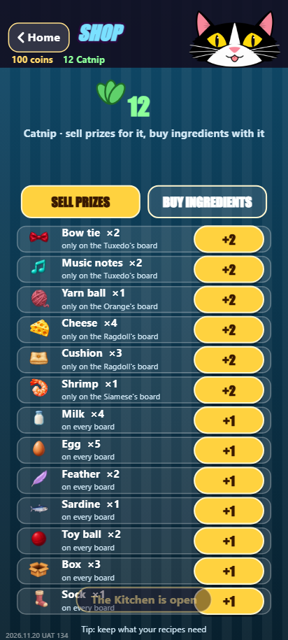
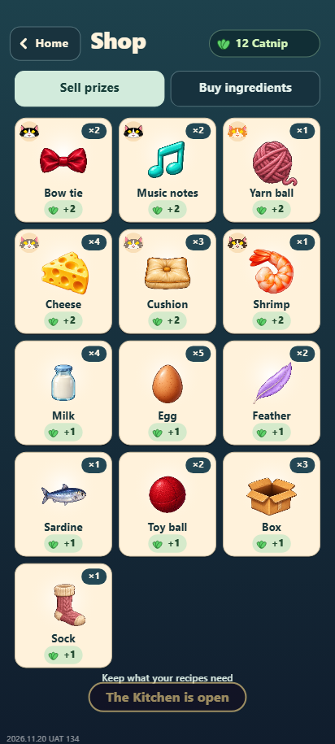
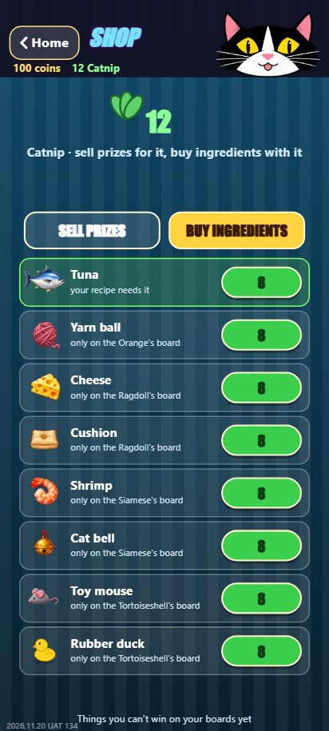
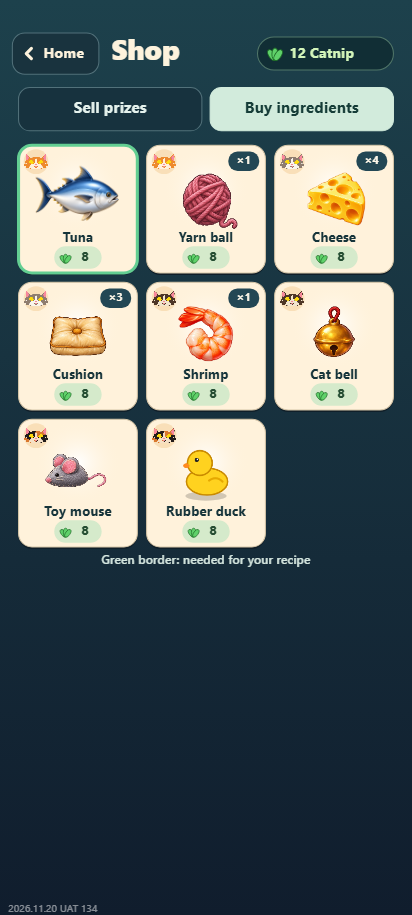
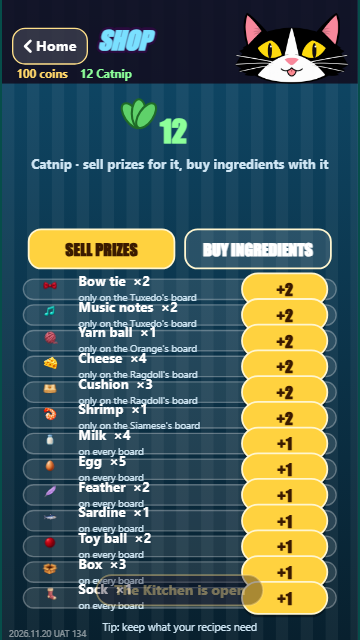
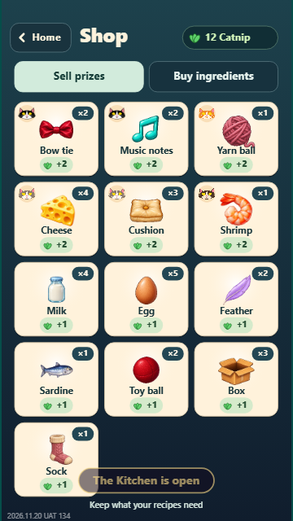
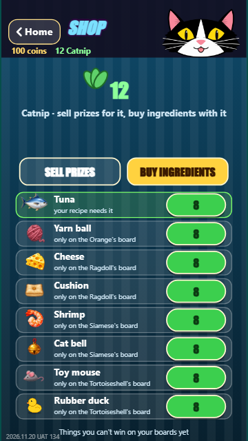
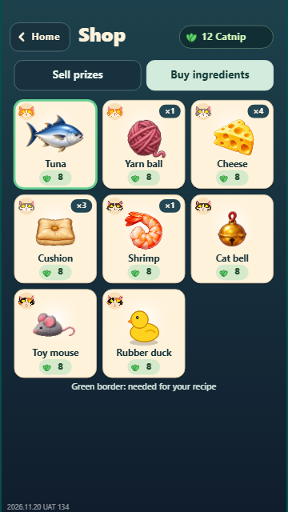

# CP-103 Shop redesign mock-up

## Before and after

| Viewport and tab | Before · UAT 134 | After · CP-103 |
| --- | --- | --- |
| 412 × 915 · Sell prizes |  |  |
| 412 × 915 · Buy ingredients |  |  |
| 360 × 640 · Sell prizes |  |  |
| 360 × 640 · Buy ingredients |  |  |

Both tabs use a three-column grid with the existing prize art centered on warm cards. A count badge shows how many the player owns, a small approved cat face marks board-specific items, and a leaf next to the price shows that the transaction uses Catnip. The balance shares one line with Home and Shop. A green border marks ingredients needed for the current recipe, and the whole card is tappable.

**Jenny’s decision.** Are the small cat faces clear enough on the shorter screen, or should the cards also name the cat?

## Validation

The stills come from the published UAT 134 runtime and the local mock-up with the same sample inventory, recipe, and balance. Desktop Chrome touch checks passed at both sizes for Home and tab navigation, full-grid fit with all 18 prizes, sell payouts, purchases, insufficient Catnip, the pantry cap, and saving Catnip. The original Sell prizes rows overlap at 360 × 640 with this inventory. Phone UAT is pending.

The runnable mock-up is in `work/cp103-mock`. Serve that folder locally and open `index.html` for the mock-up or `before.html` for UAT 134. `build.py` accepts a path to the UAT 134 update JSON when a later build is live. Mock-up only. No game update was published.
