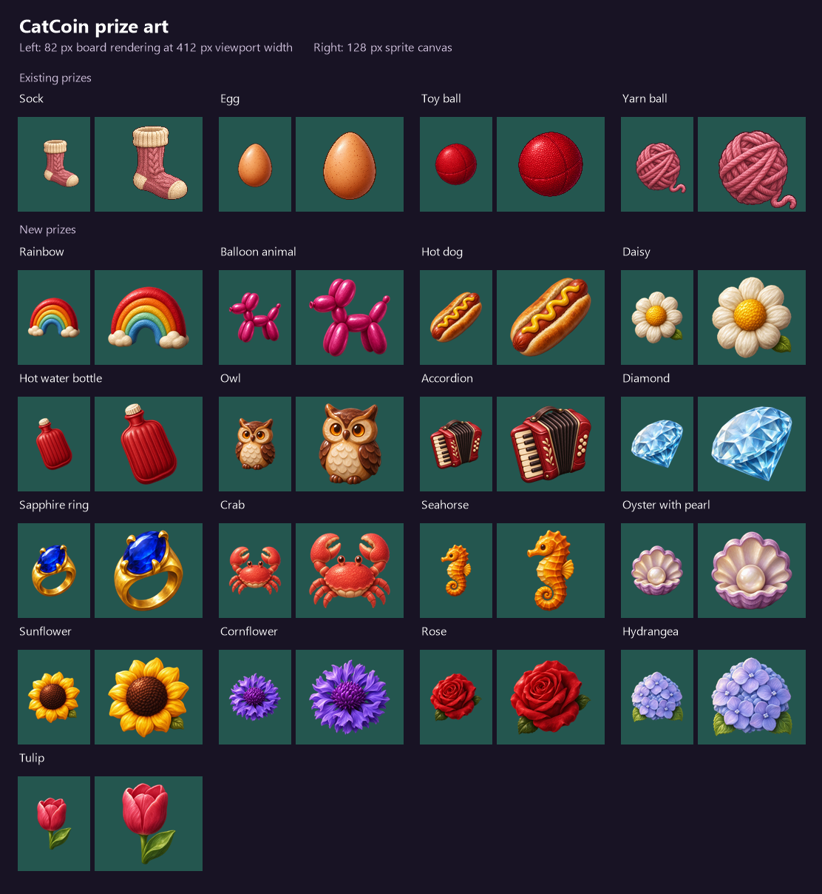

# CP-105 New prizes: art

## Final art · approved after rainbow correction

[Prize sheet at board size and enlarged](../work/cp105-prizes/review-2/sheet.png) · [Collections flowers and vase study](../work/cp105-prizes/review-2/collections-flowers.png) · [Diamond twinkle](../work/cp105-prizes/review-2/diamond-twinkle-preview.gif)

The eleven revisions are in `work/cp105-prizes/review-2`. Jenny approved the second pass with one final rainbow correction. The rainbow now uses a true semicircle and seven equally spaced, concentric bands in the same compact width. Its translucent light blends from red on the outside through orange, yellow, green, blue and indigo to violet on the inside. The owl, oyster, balloon dog, diamond and six flowers use more realistic forms and materials. The sheet also shows the six picks from the first pass.

The board flowers have short cut stems. The six matching 128 × 208 Collections sprites in `collections/` extend those stems while keeping the blooms at the same scale and light. The vase study shows how they can fan out together.

The diamond’s sharp rays flash across different facets with colour glints. The loop has 42 frames over 1.75 s. The [transparent frame atlas](../work/cp105-prizes/review-2/diamond-twinkle-frames.png) uses 128 × 128 cells in seven columns, read left to right and top to bottom at 24 fps. The GIF shows a board-size composite and an enlarged view. All eleven 128 × 128 board sprites were also checked in the local UAT 134 renderer. See the [rainbow board still](../work/cp105-prizes/review-2/board/rainbow-412x915.png) and the other stills beside it.

## First pass

| Prize | Art | Board still |
| --- | --- | --- |
| Rainbow | Five thick bands with cream cloud ends. | [View](../work/cp105-prizes/board/rainbow-412x915.png) |
| Balloon animal | Magenta balloon dog with separated legs, muzzle and tail. | [View](../work/cp105-prizes/board/balloon-animal-412x915.png) |
| Hot dog | Toasted bun and a bold mustard zigzag. | [View](../work/cp105-prizes/board/hot-dog-412x915.png) |
| Daisy | One ivory flower with a gold centre. | [View](../work/cp105-prizes/board/daisy-412x915.png) |
| Hot water bottle | Red ribbed rubber with a pale screw cap. | [View](../work/cp105-prizes/board/hot-water-bottle-412x915.png) |
| Owl | Tan and chocolate owl with large amber eyes. | [View](../work/cp105-prizes/board/owl-412x915.png) |
| Accordion | Cream piano keys and dark bellows carry the silhouette. | [View](../work/cp105-prizes/board/accordion-412x915.png) |
| Diamond | Static icy-blue stone with crisp facets. | [View](../work/cp105-prizes/board/diamond-412x915.png) |
| Sapphire ring | Gold loop and a large saturated blue stone. | [View](../work/cp105-prizes/board/sapphire-ring-412x915.png) |
| Crab | Raised claws and an oval body match the Water slot. Crab also appears in the older Ocean emoji collection. | [View](../work/cp105-prizes/board/crab-412x915.png) |
| Seahorse | Left-facing snout and curled tail match the Water slot. | [View](../work/cp105-prizes/board/seahorse-412x915.png) |
| Oyster with pearl | Open, fan-shaped shell with a large pearl for the Clam slot. | [View](../work/cp105-prizes/board/oyster-412x915.png) |
| Sunflower | Gold petals and a dark centre. | [View](../work/cp105-prizes/board/sunflower-412x915.png) |
| Cornflower | Purple petals around a prominent purple centre. | [View](../work/cp105-prizes/board/cornflower-412x915.png) |
| Rose | Layered red petals and green leaves. | [View](../work/cp105-prizes/board/rose-412x915.png) |
| Hydrangea | Periwinkle cluster. The individual florets are clearest in the enlarged view. | [View](../work/cp105-prizes/board/hydrangea-412x915.png) |
| Tulip | Upright red-pink cup with a green leaf. | [View](../work/cp105-prizes/board/tulip-412x915.png) |
| 18 | Open for Jenny’s next prize idea. | |

**Jenny’s decisions.** I recommend replacing the Water page’s Clam slot with Oyster with Pearl and updating the slot’s outline to show the open shell. Decide whether to keep the hydrangea in the flower set and whether to follow up with a star-like twinkle for the diamond.

**Validation.** Checked the UAT 134 prize art and collection catalogue before painting. Crab and Seahorse reuse planned Water subjects. The Oyster is the proposed Clam replacement. All 17 sprites are transparent 128 × 128 PNGs. The sheet compares the same 82 px board canvas and 128 px enlarged canvas for every sprite. Each still uses the normal prize renderer at the same position in a local desktop UAT 134 board. Phone review is pending.
