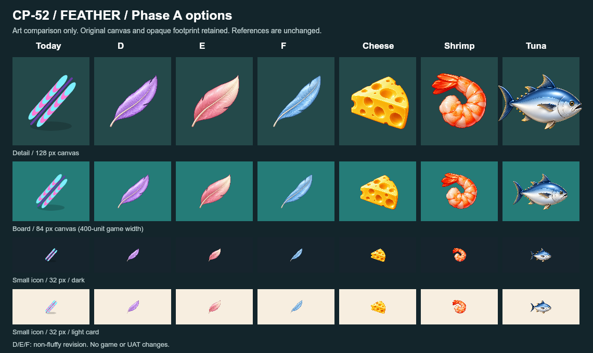
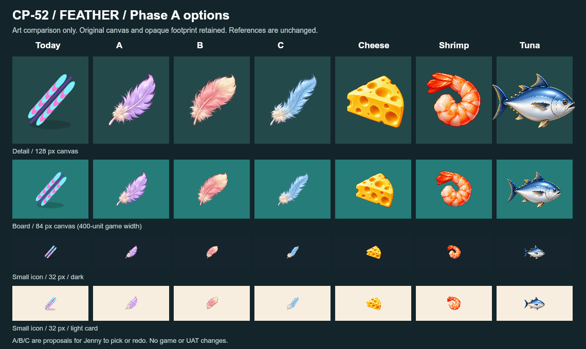
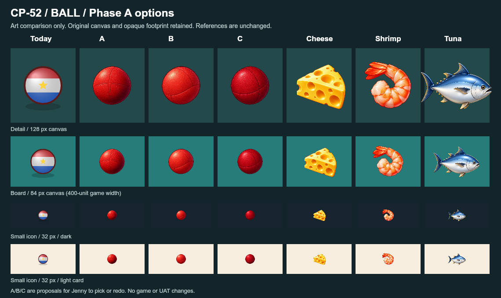
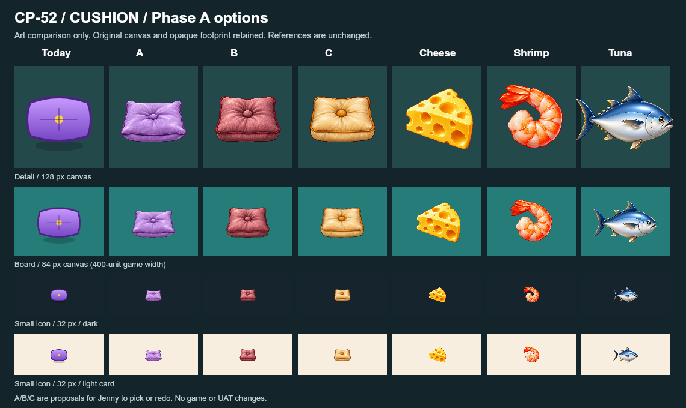

# CP-52 Prize art refresh — Phase A review

November 16, 2026. **Phase A feather revision complete; stopped before Phase B.** Jenny approved all the ball and cushion artwork and requested a feather that is not fluffy. No individual ball/cushion variant was singled out; keep all approved variants available.

**Current feather review:** D = sleek lavender, E = blush with ivory tip, F = sleek powder blue. All have closed smooth vanes, fine diagonal barbs, a curved shaft and a bare quill, without down or wispy fluff. New transparent 128×128 files are `feather-d.png`, `feather-e.png`, `feather-f.png` in `CP-52-evidence/`; original A/B/C proposals below are retained as superseded history. Built-in image_gen prompts: `generation-feather-v2.json`; full-resolution originals: `masters/feather-{d,e,f}.png`.

Checked the revised sheet at detail, board and 32 px icon sizes on dark/light backgrounds. The smooth silhouettes and shafts remain visible; fine barb texture softens at icon size. Same current-art canvas and footprint fitting as the first pass; recorded in `validation-feather-v2.json`. New feather choice/approval remains pending. Ball/cushion artwork was not revised. No game or UAT changes. The PM reads this report directly; no message sent.

| Prize | A | B | C |
|---|---|---|---|
| Feather | Lavender, cream down, curved shaft | Blush and ivory, fuller vane | Powder blue, cream down, airy vane |
| Toy ball | Bright red, crossing curved seams | Warm red, offset panel seams, softer shine | Cherry red, coarser pebbling, offset crossing seams |
| Cushion | Lavender plush, purple piping | Dusty rose woven fabric, burgundy piping | Honey cream fabric, caramel piping |

Nine transparent PNG proposals: `CP-52-evidence/{feather,ball,cushion}-{a,b,c}.png`. Each is 128×128, like today's generated canvas. Full-resolution generated originals are in `masters/`. Built-in image_gen painted one prize/variant per call. Exact prompts and generation provenance are in `generation.json`; no fallback API used.

## Relevant validation and limits

- Current art and the approved treat references were exported from UAT 66 source through the existing desktop canvas harness. Reference treats were only extracted for comparison, never repainted.
- New art was fitted to each current object's opaque bounding rectangle (alpha >64, excluding its faint cast shadow), on the original 128×128 canvas. `validation.json` records target and output bounds and transparency. `contact-sheets.cjs` performs canvas fitting and presentation only; painting comes from image_gen.
- Each sheet includes Today, A/B/C and cheese/shrimp/tuna: a detail row, board-scale row (84 px square sprite box at 400-unit game width; tuna follows its existing 114 px box), and 32 px icon boxes on dark and light backgrounds. Teal is a comparison swatch, not a generated layout or in-game screenshot. These are isolated art previews, not phone UAT evidence.
- Visually inspected all three sheets. Feathers read as feathers; fine wisps soften at icon size, especially the pale blue against the light card. Balls retain seams and red volume; tiny pebbling merges at icon size. Cushions retain puffy corners and the central tuft; fine weave merges at icon size. Jenny decides style fit and picks or redo.
- No game files, UAT payload, production, physics, collider, pickup or release version were edited. No UAT was published, so checkpoint is not applicable.

Phase B waits for Jenny's picks, PM authorization and CP-50 in UAT. No implementation or phone test plan yet.

## PM handoff status

Phase A assets/report were committed and pushed to `wip/uat` as `c43aecc` (CP-52 Phase A prize art options and contact sheets). Jenny clarified that the PM reads this report directly; no Claude access or PM message is needed. Phase A is complete. Stopped here pending PM review and Jenny's picks/redo; Phase B remains on hold.
