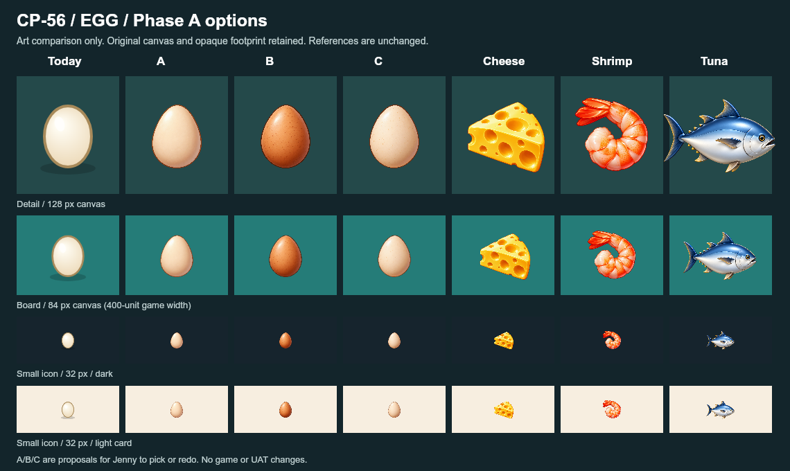
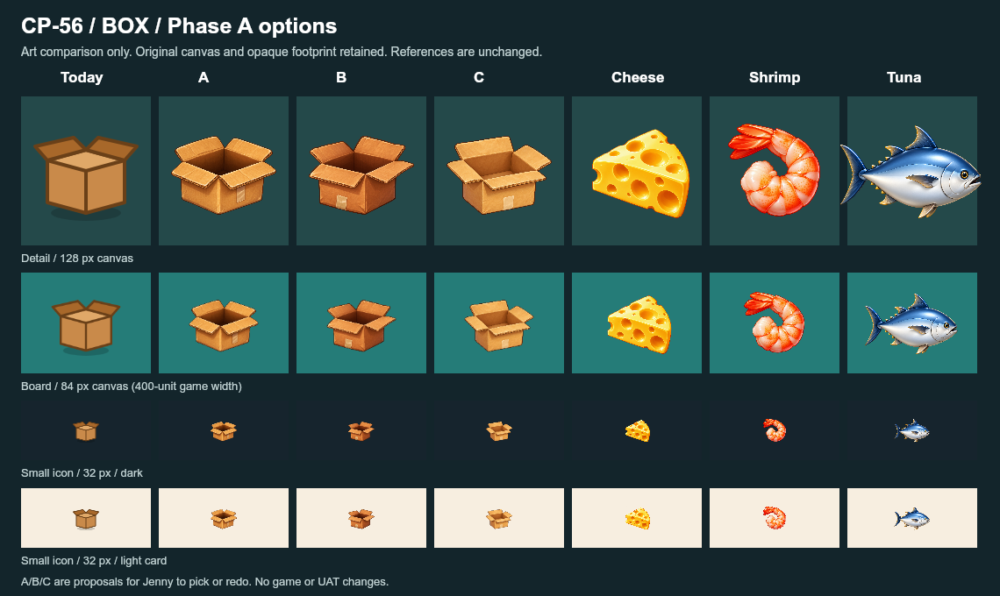

# CP-56 Phase B — UAT 72

**Published to UAT only: 2026.11.16 UAT 72 / APK7 (20261116220000)**, based on UAT 71 (20261116210000, CP-54). PM go November 16; selected **sock B, fish biscuit A, sardine B, egg B, box A**. Phone receipt and sign-off pending.

## Changes and validation

- Preloaded the five approved 128×128 PNGs into the shared prize-art cache used by the board, Album, Kitchen ingredients, goal rows, end card and pickup artwork. Existing size calculations, colliders and frozen pickup behavior are retained.
- Source: `work/cp72/build.py`, pinned published UAT 71; selected assets in `work/cp72/art/cp56-*.png`. Exact source comparison permits only the build label and five cache preloads.
- **15/15 focused desktop checks passed** (`work/cp72/checks72.cjs`; `CP-56-evidence/uat72/checks72.json`): exact approved pixels, identical board size/aspect/opaque-share calculations, seven simultaneous pickups with identical frame traces and sound calls against UAT 71, Album coverage and no frame errors at both sizes.
- Visually inspected real-game board and Album renders at **360×640 and 412×915**: `CP-56-evidence/uat72/board-<size>.png` and `album-<size>.png`. Additional Home goals, Kitchen and end-card renders are beside them. Board evidence substitutes the selected five IDs into Level 2's existing prize bodies solely in the desktop fixture; shipped levels are unchanged. Album/Kitchen use test inventory. These are desktop evidence, not phone evidence.
- Reproducible build; complete 45-file game-only runtime, adding five PNGs to UAT 71. Backup verified at `uat/backups/before-UAT72-20261116220000`. JSON: 52,192,584 bytes; SHA256 `53857d7c67bf3ba37477c2cebf8d8d2bd24f9bfae6c1170bebd2e50b36b8c158`. Existing OneDrive item preserved. Fresh anonymous cloud download: HTTP 200, exact staged bytes/hash, same shared item, ETag 108 (`CP-56-evidence/uat72/cloud-verification.json`). Required GitHub checkpoint is the final close-out step.
- Device receipt, appearance, save continuity, sound and FPS await Jenny's phone UAT. No pending implementation decision. No Claude access or messages used.

## UAT test plan

1. Accept **UAT 72** in the UAT app; confirm your saved progress remains.
2. Play boards/drops containing Sock, Fish biscuit, Sardine, Egg and Box. Expect rose cable-knit sock B, smiling golden fish biscuit A, indigo/silver sardine B, speckled brown egg B and open honey-kraft box A. Check board size and handling against UAT 71.
3. Check all five in the Album and wherever available in Kitchen ingredients, Home/in-round goals and end cards. Expect the same paintings, clear edges and no old placeholders or clipping.
4. Collect several prizes together. Expect the same busy overlapping pickup sizes, timing and sounds as UAT 71; watch for errors or slowdown.

```text
CP-56 passes UAT 72
```

---

## Phase A history

# CP-56 Prize art batch 2 — Phase A review

November 16, 2026. **Approved: sock B, biscuit A, sardine B, egg B, box A. Phase B published above.**





| Prize | A | B | C |
|---|---|---|---|
| Sock | Lavender knit, cream cuff/heel/toe | Dusty rose cable knit, ivory trim | Teal knit, honey trim |
| Fish biscuit | Golden-orange, simple smiling face | Honey gold, stamped gill and docking holes | Cheddar orange, moulded detail and toasted speckles |
| Sardine | Blue back, pearl-silver belly | Indigo back, spotted silver sides | Blue-green back, warmer silver highlights |
| Egg | Smooth warm ivory | Speckled caramel brown | Pale cream with sparse tan freckles |
| Box | Honey kraft, open flaps and tape | Russet kraft, worn folds | Light golden kraft, broad flaps |

## Deliverables and validation

- Fifteen transparent **128×128 PNGs**: `CP-56-evidence/{sock,biscuit,sardine,egg,box}-{a,b,c}.png`. Full-resolution originals are in `masters/`. Built-in image_gen painted one prize/variant per call; exact prompts and provenance are in `generation.json`. No fallback API used.
- Today's art and cheese/shrimp/tuna references were exported from current UAT 70 source, `work/cp70/release.html`, using the existing desktop canvas harness (`export.cjs`). Approved feather D, ball C and cushion C were also inspected as style references. References were not repainted.
- `contact-sheets.cjs` fits generated artwork to each current object's opaque bounding rectangle (alpha >64, excluding the faint shadow), following CP-52. Master bounds also use alpha >64 to exclude faint stray pixels. All 15 proposals pass transparency and 128×128 canvas checks; rendered opaque bounds match the target within 1 px after resampling. Recorded bounds/transparency are in `validation.json`.
- Each sheet shows Today, A/B/C and reference treats: 128 px detail, board-scale 84 px sprite boxes at 400-unit game width (tuna follows its existing larger box), and 32 px icons on dark and cream backgrounds. Teal is a comparison swatch, not a generated layout or a game screenshot.
- Visually inspected all five sheets. Socks retain distinct cuffs/toes; crackers retain fish silhouettes; sardines retain silver bodies and forked tails; eggs retain shell volume; boxes retain open interiors and flaps. Fine knit, crumb, scales, freckles and corrugation soften at 32 px. Brown egg B contrasts most strongly with cream; pale eggs have subtler edges. Sardine options face right, while today's placeholder faces left; the canvas and bounding footprint are retained.

No game integration or UAT publication was performed. These are isolated art previews, not phone evidence. No checkpoint is applicable. Jenny chooses an option per prize or requests a redo; Phase B requires the PM's go. No Claude access or messages were used.

## GitHub close-out

Phase A assets, contact sheets, prompts, validation and this report are included in the CP-56 commit on `wip/uat`. Phase B remains on hold for review.
