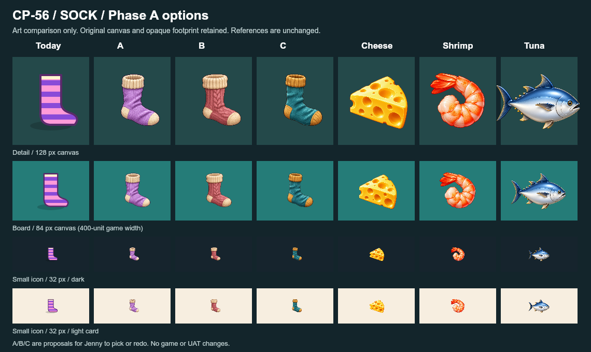
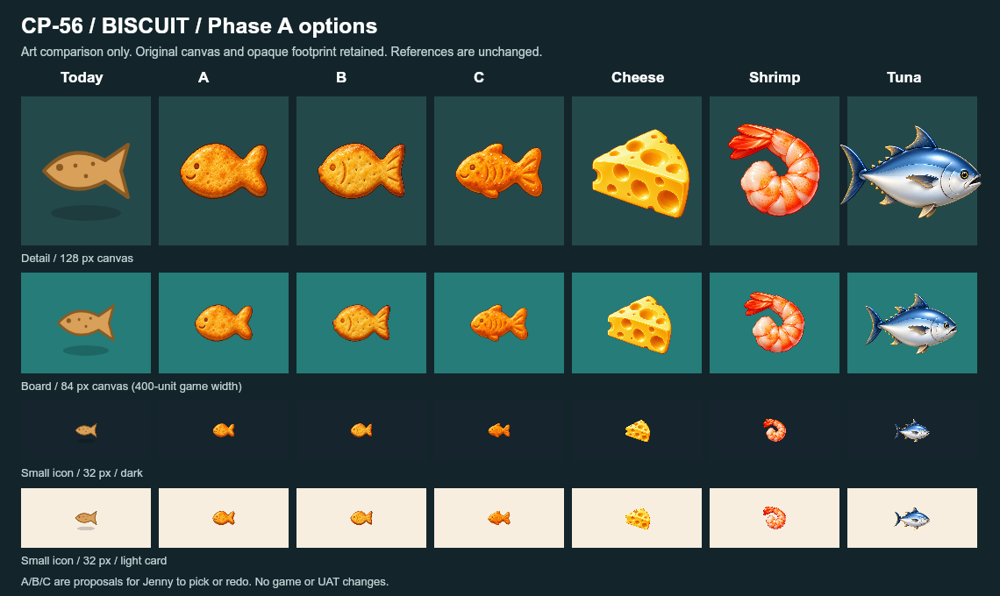
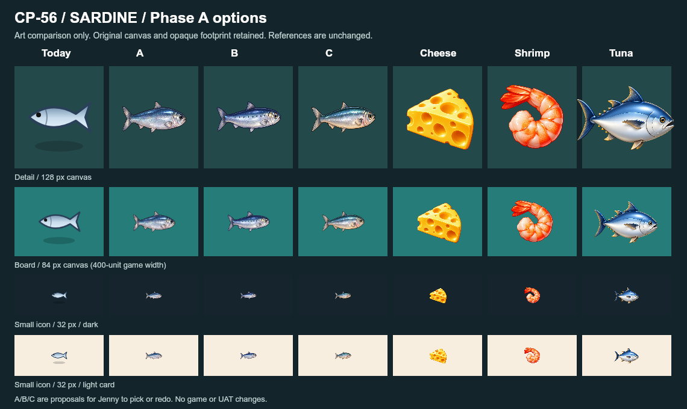

# CP-56 Prize art batch 2 — Phase A review

November 16, 2026. **Art options only; waiting for Jenny's picks or redo. Phase B is not started.**

| Prize | A | B | C |
|---|---|---|---|
| Sock | Lavender knit, cream cuff/heel/toe | Dusty rose cable knit, ivory trim | Teal knit, honey trim |
| Fish biscuit | Golden-orange, simple smiling face | Honey gold, stamped gill and docking holes | Cheddar orange, moulded detail and toasted speckles |
| Sardine | Blue back, pearl-silver belly | Indigo back, spotted silver sides | Blue-green back, warmer silver highlights |
| Egg | Smooth warm ivory | Speckled caramel brown | Pale cream with sparse tan freckles |
| Box | Honey kraft, open flaps and tape | Russet kraft, worn folds | Light golden kraft, broad flaps |

## Deliverables and validation

- Fifteen transparent **128×128 PNGs**: `CP-56-evidence/{sock,biscuit,sardine,egg,box}-{a,b,c}.png`. Full-resolution originals are in `masters/`. Built-in image_gen painted one prize/variant per call; exact prompts and provenance are in `generation.json`. No fallback API used.
- Today's art and cheese/shrimp/tuna references were exported from current UAT 70 source, `work/cp70/release.html`, using the existing desktop canvas harness (`export.cjs`). Approved feather D, ball C and cushion C were also inspected as style references. References were not repainted.
- `contact-sheets.cjs` fits generated artwork to each current object's opaque bounding rectangle (alpha >64, excluding the faint shadow), following CP-52. Master bounds also use alpha >64 to exclude faint stray pixels. All 15 proposals pass transparency and 128×128 canvas checks; rendered opaque bounds match the target within 1 px after resampling. Recorded bounds/transparency are in `validation.json`.
- Each sheet shows Today, A/B/C and reference treats: 128 px detail, board-scale 84 px sprite boxes at 400-unit game width (tuna follows its existing larger box), and 32 px icons on dark and cream backgrounds. Teal is a comparison swatch, not a generated layout or a game screenshot.
- Visually inspected all five sheets. Socks retain distinct cuffs/toes; crackers retain fish silhouettes; sardines retain silver bodies and forked tails; eggs retain shell volume; boxes retain open interiors and flaps. Fine knit, crumb, scales, freckles and corrugation soften at 32 px. Brown egg B contrasts most strongly with cream; pale eggs have subtler edges. Sardine options face right, while today's placeholder faces left; the canvas and bounding footprint are retained.

No game integration or UAT publication was performed. These are isolated art previews, not phone evidence. No checkpoint is applicable. Jenny chooses an option per prize or requests a redo; Phase B requires the PM's go. No Claude access or messages were used.

## GitHub close-out

Phase A assets, contact sheets, prompts, validation and this report are included in the CP-56 commit on `wip/uat`. Phase B remains on hold for review.
