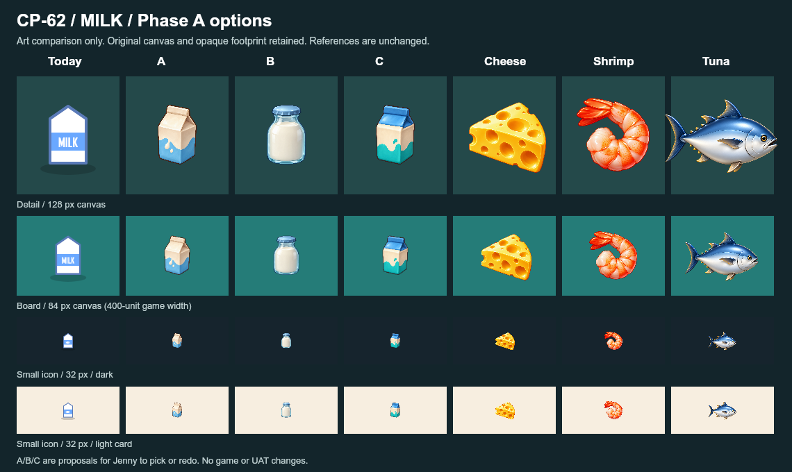
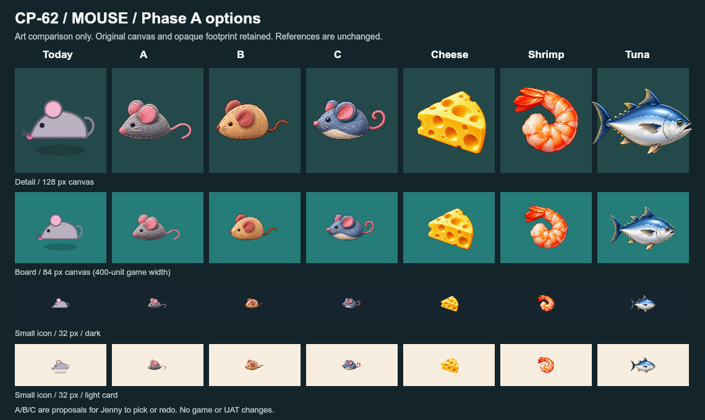
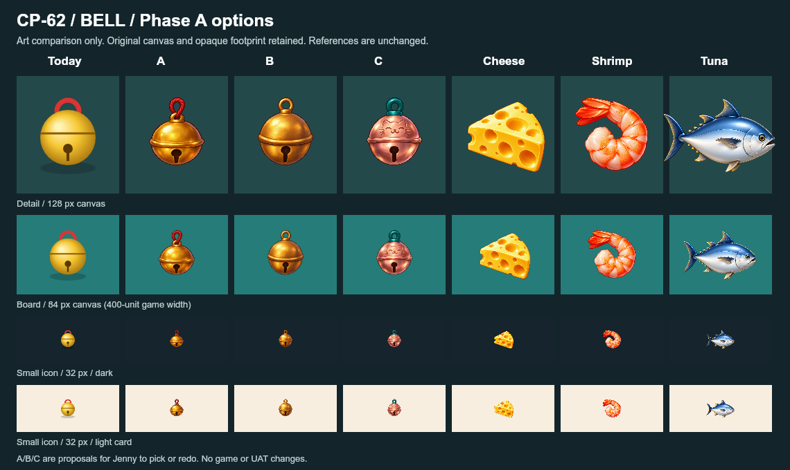
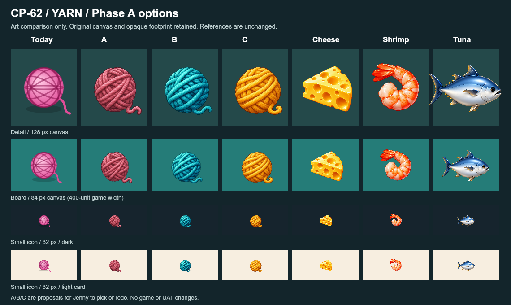

# CP-62 Phase B — UAT 80

**Published to UAT only: 2026.11.16 UAT 80 / APK7 (20261116235951)**, on published UAT 79 (20261116235950, CP-58 Yawn). Jenny authorized Phase B in this chat, corrected milk to **B**, then authorized random existing A/B/C colours per **music notes, cushions and yarn** prize. Fixed picks: **milk B, mouse A, bell A, bowtie A**. Phone receipt and sign-off pending.

## Changes and validation

- Shared prize-art cache now uses the selected paintings everywhere those prizes appear. Notes, yarn and cushions choose among existing A/B/C paintings per board prize; each keeps its colour through pickup, loss and the CP-58 mitt grab. UI icons use notes C, yarn A and cushion C. Colour selection has separate art-only state and does not consume gameplay RNG or change prize IDs.
- Source: `work/cp80/build.py`, pinned to exact UAT 79 source; art in `work/cp80/art/`; isolated colour rendering in `colours.js`. Source-scope check allows only the label, image preloads, five owner-aware drawing calls and colour metadata wrappers. Existing prize dimensions, colliders, levels and pickup motion/timing/audio remain unchanged.
- **33/33 focused desktop checks passed** (`work/cp80/checks80.cjs`, `CP-62-evidence/uat80/checks80.json`): exact selected pixels, all nine colour variants, unchanged size/aspect/opaque-share calculations, stable colour choices and transfer through pooled pickup/loss, cache restoration, no gameplay RNG use during variant drawing, seven simultaneous pickups with identical frame traces and sound calls to UAT 79, Album coverage, and no frame errors at both sizes.
- Visually inspected real-game board, colour-variant board, pickup and Album renders at **360×640 and 412×915** in `CP-62-evidence/uat80/`. Additional Home goals, Kitchen and end-card renders are beside them. Board fixtures substitute/add reviewed prizes solely for desktop evidence; the colour grid forces all three variants for comparison, and the pickup fixture advances several flights to show their art. Shipped levels and pickup schedules are unchanged. These are desktop renders, not phone evidence.
- Reproducible build; complete **62-file** game-only runtime (47-file UAT 79 plus 15 PNGs; only index.html changes among existing files). Backup verified at `uat/backups/before-UAT80-20261116235951`; existing OneDrive item preserved. JSON: **53,889,324 bytes**, SHA256 `2c44b18d715e031e756ecf5856b477f50c48b349b769110b97e9cab9169efdfc`.
- Fresh anonymous cloud download verified: HTTP 200, exact staged size/hash, same shared item, ETag 116 (`CP-62-evidence/uat80/cloud-verification.json`). Required `python work/checkpoint.py` completed: **2c419b5** on `wip/uat`, pushed. Final CP-62 close-out documentation is committed with the ticket name. Device receipt, appearance, save continuity, sound and FPS await Jenny's phone UAT. No Claude access or messages to anyone were used.

## UAT test plan

1. Accept **UAT 80** in the UAT app; confirm saved progress remains.
2. Check milk (glass bottle B), gray felt mouse A, gold bell with red loop A and red bow tie A on boards, goals, Album, Kitchen and end cards wherever available. Expect the selected paintings with their previous sizes and handling.
3. Play boards containing music notes, yarn and cushions. Expect different prizes to use A/B/C colours: gold/purple/turquoise notes, rose/teal/gold yarn and lavender/rose/gold cushions. Each individual prize must keep its colour as it moves and during pickup/loss; UI icons stay at their default colour. Not every board must contain all colours.
4. Collect several prizes together. Expect the same busy overlapping pickup timing, sizes and sounds as UAT 79, with no flickering colours or slowdown. If the wheel's Yawn grabs a coloured prize, its colour should stay stable in the mitt.

```text
CP-62 passes UAT 80
```

---

# CP-62 Prize art batch 3 — Phase A review

November 16, 2026. **Phase A history; selections and Phase B publication are above.** Three options each for milk, toy mouse, bell, music notes, bow tie and yarn. Phase B requires the PM's go.








| Prize | A | B | C |
|---|---|---|---|
| Milk | Ivory/sky-blue carton | Glass bottle, blue cap | Cream/turquoise carton, blue top |
| Toy mouse | Gray felt, pink ears and cord | Oatmeal plush, rose ears | Blue-gray cloth, cream belly |
| Bell | Golden brass, red cord loop | Brushed honey brass, metal ring | Rose gold, teal ring, etched cat face |
| Music notes | Bevelled gold | Purple enamel, gold edge | Turquoise enamel |
| Bow tie | Red satin | Royal-blue satin | Plum velvet, rose knot |
| Yarn | Dusty rose wool | Teal-blue wool | Honey-gold wool |

## Deliverables and validation

- Eighteen transparent **128×128 PNGs** in `CP-62-evidence/{milk,mouse,bell,notes,bowtie,yarn}-{a,b,c}.png`; full-resolution originals in `masters/`. Painted with built-in image_gen, one prize/variant per call. Exact prompts and original paths: `generation.json`. One plum bow tie with a background artifact was rejected and regenerated.
- Today's six sprites and unchanged cheese/shrimp/tuna references exported from current UAT 79 source, `work/cp79/release.html`, by `export.cjs`. CP-56's approved biscuit sheet was inspected for the batch style and comparison format.
- `contact-sheets.cjs` follows CP-56: fit each generated painting to today's opaque bounding rectangle (alpha >64), preserving the 128×128 canvas. All 18 output bounds match their targets exactly and all contain fully transparent pixels; measurements in `validation.json`. Fitting is presentation processing only; no code-painted replacement art.
- Visually inspected all six sheets: Today, A/B/C and unchanged reference treats at 128 px detail, 84 px board-scale canvas (400-unit game width), and 32 px icons on dark/cream backgrounds. Tuna retains its larger comparison box. Teal is a comparison swatch, not a game screenshot or generated layout.
- Limits: fine stitching, velvet and wool detail soften at 32 px. Milk stays small because its current footprint is narrow; the bottle's cream fill has a subtler edge on cream. Bell A's cord makes its metal body narrower than B/C within the same total bounds. Bow tie B has a dark blue edge on dark backgrounds. These are art previews, not phone evidence or integrated-game validation.

No game integration or UAT publication was performed; no checkpoint applies. Jenny chooses A/B/C per prize or requests a redo. No Claude access, agents or messages to anyone were used. Stopped at Phase A.

## GitHub close-out

The CP-62 report, brief, art options, masters, contact sheets, prompts and validation are saved on `wip/uat` in the ticket-named CP-62 commit. The ticket close-out is committed and pushed to GitHub.


