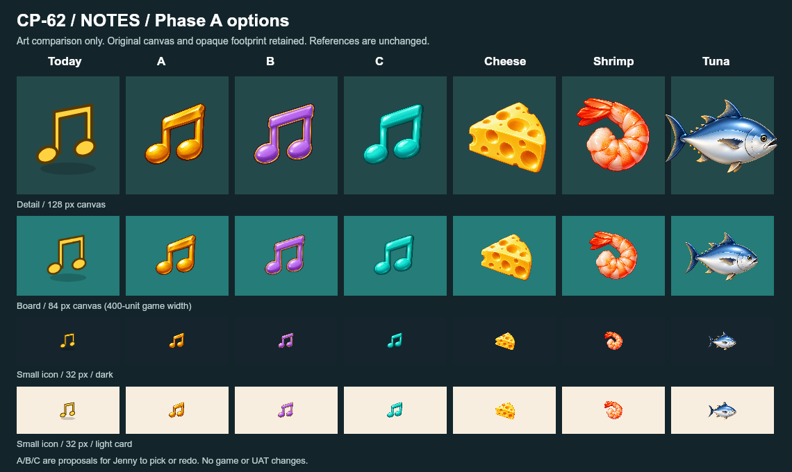
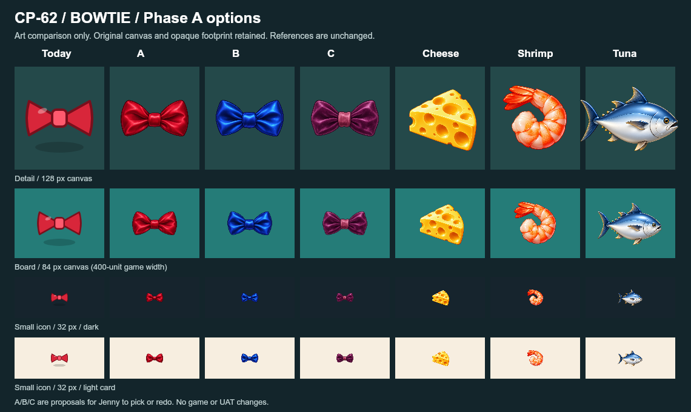

# CP-62 Prize art batch 3 — Phase A review

November 16, 2026. **Phase A complete; Jenny's choices pending.** Three options each for milk, toy mouse, bell, music notes, bow tie and yarn. Phase B requires the PM's go.

| Prize | A | B | C |
|---|---|---|---|
| Milk | Ivory/sky-blue carton | Glass bottle, blue cap | Cream/turquoise carton, blue top |
| Toy mouse | Gray felt, pink ears and cord | Oatmeal plush, rose ears | Blue-gray cloth, cream belly |
| Bell | Golden brass, red cord loop | Brushed honey brass, metal ring | Rose gold, teal ring, etched cat face |
| Music notes | Bevelled gold | Purple enamel, gold edge | Turquoise enamel |
| Bow tie | Red satin | Royal-blue satin | Plum velvet, rose knot |
| Yarn | Dusty rose wool | Teal-blue wool | Honey-gold wool |

## Deliverables and validation

- Eighteen transparent **128×128 PNGs** in `CP-62-evidence/{milk,mouse,bell,notes,bowtie,yarn}-{a,b,c}.png`; full-resolution originals in `masters/`. Painted with built-in image_gen, one prize/variant per call. Exact prompts and original paths: `generation.json`. One plum bow tie with a background artifact was rejected and regenerated.
- Today's six sprites and unchanged cheese/shrimp/tuna references exported from current UAT 79 source, `work/cp79/release.html`, by `export.cjs`. CP-56's approved biscuit sheet was inspected for the batch style and comparison format.
- `contact-sheets.cjs` follows CP-56: fit each generated painting to today's opaque bounding rectangle (alpha >64), preserving the 128×128 canvas. All 18 output bounds match their targets exactly and all contain fully transparent pixels; measurements in `validation.json`. Fitting is presentation processing only; no code-painted replacement art.
- Visually inspected all six sheets: Today, A/B/C and unchanged reference treats at 128 px detail, 84 px board-scale canvas (400-unit game width), and 32 px icons on dark/cream backgrounds. Tuna retains its larger comparison box. Teal is a comparison swatch, not a game screenshot or generated layout.
- Limits: fine stitching, velvet and wool detail soften at 32 px. Milk stays small because its current footprint is narrow; the bottle's cream fill has a subtler edge on cream. Bell A's cord makes its metal body narrower than B/C within the same total bounds. Bow tie B has a dark blue edge on dark backgrounds. These are art previews, not phone evidence or integrated-game validation.

No game integration or UAT publication was performed; no checkpoint applies. Jenny chooses A/B/C per prize or requests a redo. No Claude access, agents or messages to anyone were used. Stopped at Phase A.

## GitHub close-out

The CP-62 report, brief, art options, masters, contact sheets, prompts and validation are saved on `wip/uat` in the ticket-named CP-62 commit. The ticket close-out is committed and pushed to GitHub.

