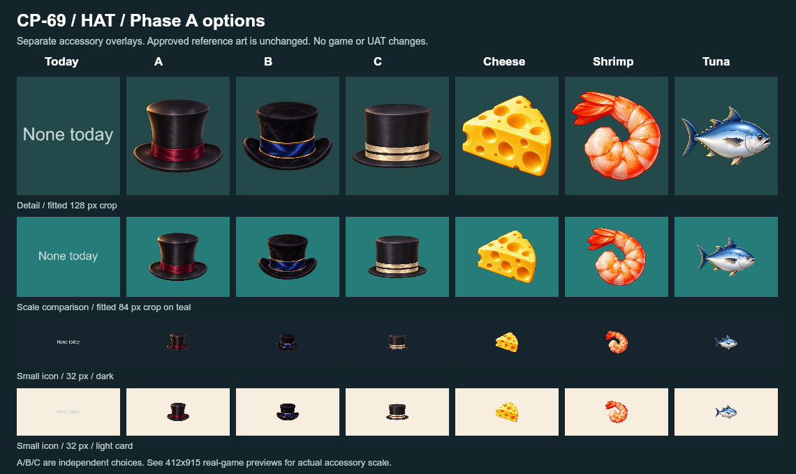
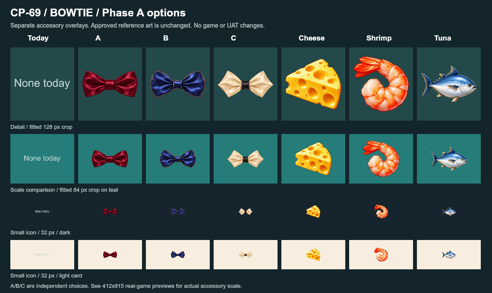
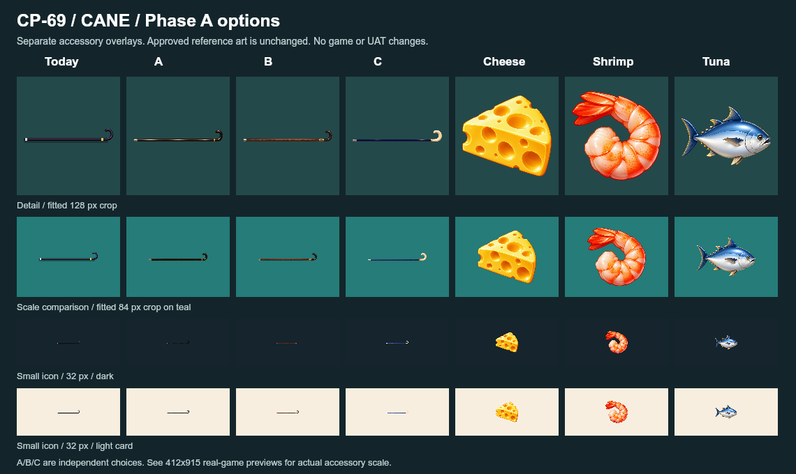
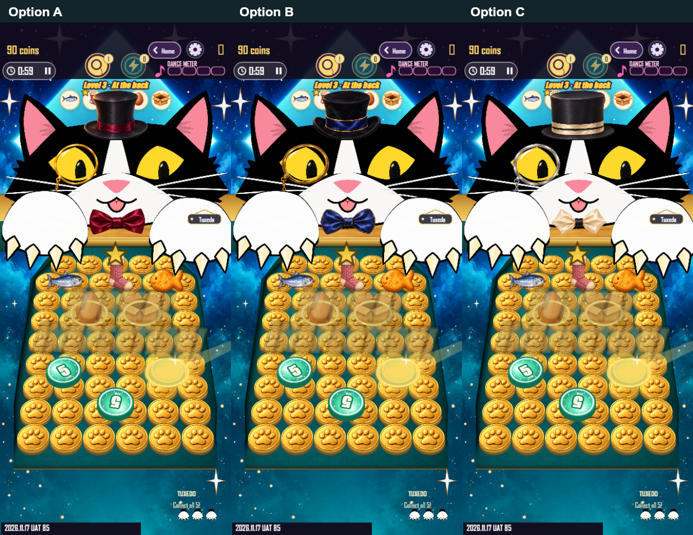

# CP-69 Formal inspection art — Phase A review

November 17, 2026. **Art options only. Waiting for Jenny's choices; Phase B has not started.**

Three separate transparent PNG options per piece, generated one accessory at a time with the built-in imagegen tool. The approved Tuxedo head is the unchanged base in the desktop game previews. No game or UAT publication.

| Piece | A | B | C |
|---|---|---|---|
| Top hat | Black silk, burgundy band | Black velvet, blue band with gold piping | Charcoal silk, ivory band with black stripe |
| Bow tie | Burgundy satin butterfly | Blue satin butterfly, gold stitching | Ivory diamond wings, black knot |
| Monocle | Smooth polished gold | Beaded antique brass | Silver with a fine inner gold line |
| Cane | Black lacquer, gold collar, silver tip | Walnut shaft, black crook, brass collar | Blue lacquer, ivory crook, gold collar |

Pick each accessory independently; the A/B/C outfits below are comparison groupings, not required sets.

Individual 412×915 views: [A](CP-69-evidence/on-cat-a-412x915.png), [B](CP-69-evidence/on-cat-b-412x915.png), [C](CP-69-evidence/on-cat-c-412x915.png). The hat overlaps the goal row; the tie sits at the chin. This overlap is permitted by the brief.

## Files and validation

- All deliverables are in `tickets/CP-69-evidence/`. The twelve fitted overlays are `<hat|bowtie|monocle|cane>-<a|b|c>.png`; original generated PNGs are in `masters/`. Hat, tie and monocle use the head's **1536×1024** canvas; cane uses the same export canvas with the present code cane's horizontal footprint. Monocles sit at the left-of-screen eye, with transparent centres so the pupil remains visible.
- Contact sheets follow CP-56: today's art (none for hat/tie; actual code stand-ins for monocle/cane), A/B/C, approved cheese/shrimp/tuna references, teal scale comparison and 32 px icons on dark/light. Crops in contact sheets are comparison sizes; the 412×915 game previews show actual placement.
- `render.cjs` fits and presents the generated art; `preview.cjs` reads UAT 85's source and changes only an in-memory desktop review instance. It draws overlays at the existing head transform and the cane at CP-63's sweep span beneath the right mitt. No release source is written. Reproduce with `node tickets/CP-69-evidence/render.cjs`, then `node tickets/CP-69-evidence/preview.cjs`.
- Checked transparent backgrounds, all twelve export dimensions, clear lens centres and the contact sheets/412×915 compositions. Details: `validation.json`, `preview-validation.json`. Final prompt set and generator mode: `generation.json`.

## Limits and pending decision

Static desktop art review only, not phone UAT or a shipped animation. Jenny chooses a hat, bow tie, monocle and cane, or requests a redo. Phase B requires the PM's go. Stopping here.

Close-out: CP-69 art, prompts, review scripts and report saved to GitHub on `wip/uat` with commit message `CP-69 Phase A formal inspection art options`. No UAT was published, so the post-publication checkpoint does not apply.
