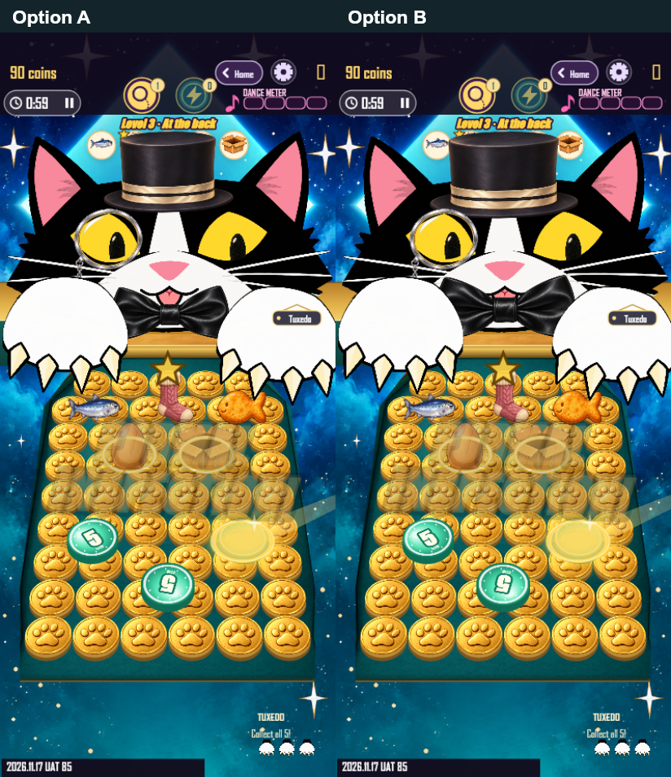
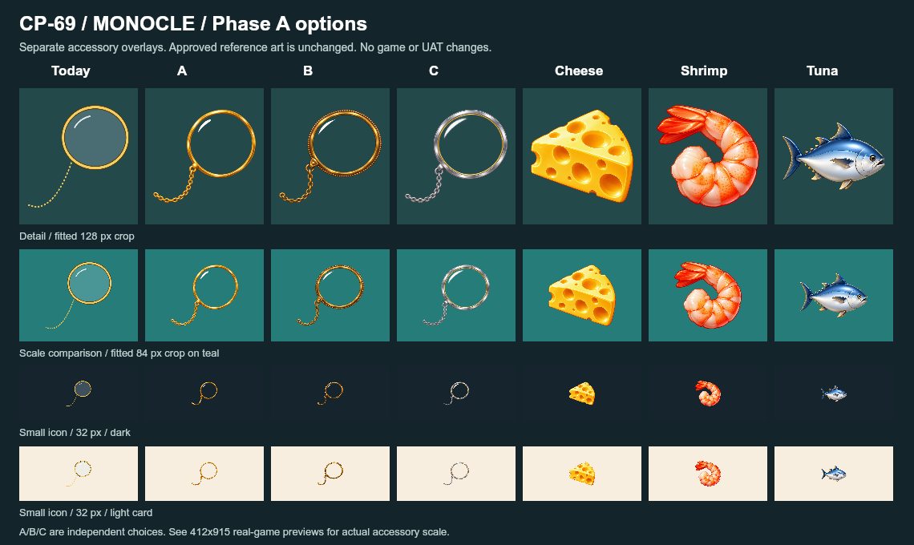

# CP-69 Round 2 — art review

November 17, 2026. **Round 2 only, complete for review. Phase B still waits for the PM’s go.**

| Piece | Round 2 A | Round 2 B |
|---|---|---|
| Bow tie | A’s butterfly shape, black satin, 30% wider | Same black tie, 55% wider |
| Hat | Hat C, 22% wider and 12% taller | Hat C, 40% wider and 20% taller |
| Monocle | Original silver C, unchanged | Original silver C, unchanged |
| Cane | Thicker black lacquer, compact rounded crook | Thicker black lacquer, knob top |

Hat and tie choices are independent. Both hat options retain C’s original painting and ivory band; both tie options use the same new black master. Hat top stays within the head canvas, with the larger brim lower on the forehead. The black canes remain readable against the gold board, so cane A’s black/gold/silver colours are retained.

Individual 412×915 views: [A](CP-69-evidence/round2/on-cat-a-412x915.png), [B](CP-69-evidence/round2/on-cat-b-412x915.png).

The approved right mitt overlaps the handles in the sweep frame, so the separate comparison exposes both handle shapes. This is static desktop art review, not animation or phone UAT.

Files: `tickets/CP-69-evidence/round2/`. Transparent fitted overlays remain 1536×1024. `render.cjs`, `preview.cjs`, and `sheet.cjs` reproduce the fittings and real-game previews. `validation.json` records alpha bounds and placements; `preview-validation.json` records the read-only UAT 85 fixture and 412×915 output. The original silver C is copied byte for byte. Visually checked both on-cat options, board canes and the handle sheet; the cat and mitt artwork are the real game assets. No game source, release, UAT publication or pickup change. No publication checkpoint applies.

Built-in imagegen made only the black tie edit and the two cane edits; hat sizes are deterministic fittings of existing C. Masters and prompts are saved beside the evidence (`masters/`, `generation.json`). Pending: Jenny’s choice of hat size, tie size and cane handle. Stopping before Phase B.

Close-out: Round 2 evidence, scripts and this report saved to `wip/uat` with commit message `CP-69 Round 2 formal inspection art review`.

---

# CP-69 Formal inspection art — Phase A review

November 17, 2026. **Art options only. Waiting for Jenny's choices; Phase B has not started.**

Three separate transparent PNG options per piece, generated one accessory at a time with the built-in imagegen tool. The approved Tuxedo head is the unchanged base in the desktop game previews. No game or UAT publication.

| Piece | A | B | C |
|---|---|---|---|
| Top hat | Black silk, burgundy band | Black velvet, blue band with gold piping | Charcoal silk, ivory band with black stripe |
| Bow tie | Burgundy satin butterfly | Blue satin butterfly, gold stitching | Ivory diamond wings, black knot |
| Monocle | Smooth polished gold | Beaded antique brass | Silver with a fine inner gold line |
| Cane | Black lacquer, gold collar, silver tip | Walnut shaft, black crook, brass collar | Blue lacquer, ivory crook, gold collar |

Pick each accessory independently; the A/B/C outfits below are comparison groupings, not required sets.

Individual 412×915 views: [A](CP-69-evidence/on-cat-a-412x915.png), [B](CP-69-evidence/on-cat-b-412x915.png), [C](CP-69-evidence/on-cat-c-412x915.png). The hat overlaps the goal row; the tie sits at the chin. This overlap is permitted by the brief.

## Files and validation

- All deliverables are in `tickets/CP-69-evidence/`. The twelve fitted overlays are `<hat|bowtie|monocle|cane>-<a|b|c>.png`; original generated PNGs are in `masters/`. Hat, tie and monocle use the head's **1536×1024** canvas; cane uses the same export canvas with the present code cane's horizontal footprint. Monocles sit at the left-of-screen eye, with transparent centres so the pupil remains visible.
- Contact sheets follow CP-56: today's art (none for hat/tie; actual code stand-ins for monocle/cane), A/B/C, approved cheese/shrimp/tuna references, teal scale comparison and 32 px icons on dark/light. Crops in contact sheets are comparison sizes; the 412×915 game previews show actual placement.
- `render.cjs` fits and presents the generated art; `preview.cjs` reads UAT 85's source and changes only an in-memory desktop review instance. It draws overlays at the existing head transform and the cane at CP-63's sweep span beneath the right mitt. No release source is written. Reproduce with `node tickets/CP-69-evidence/render.cjs`, then `node tickets/CP-69-evidence/preview.cjs`.
- Checked transparent backgrounds, all twelve export dimensions, clear lens centres and the contact sheets/412×915 compositions. Details: `validation.json`, `preview-validation.json`. Final prompt set and generator mode: `generation.json`.

## Limits and pending decision

Static desktop art review only, not phone UAT or a shipped animation. Jenny chooses a hat, bow tie, monocle and cane, or requests a redo. Phase B requires the PM's go. Stopping here.

Close-out: CP-69 art, prompts, review scripts and report saved to GitHub on `wip/uat` with commit message `CP-69 Phase A formal inspection art options`. No UAT was published, so the post-publication checkpoint does not apply.
